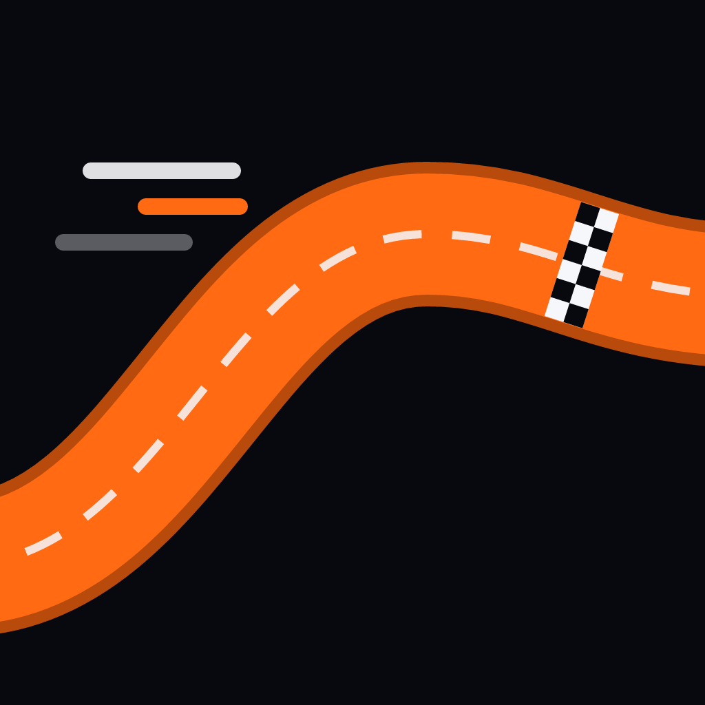
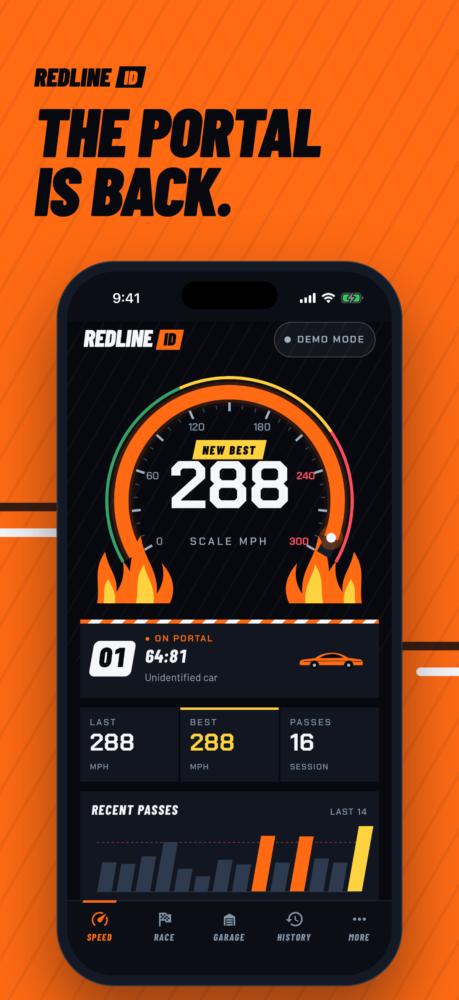
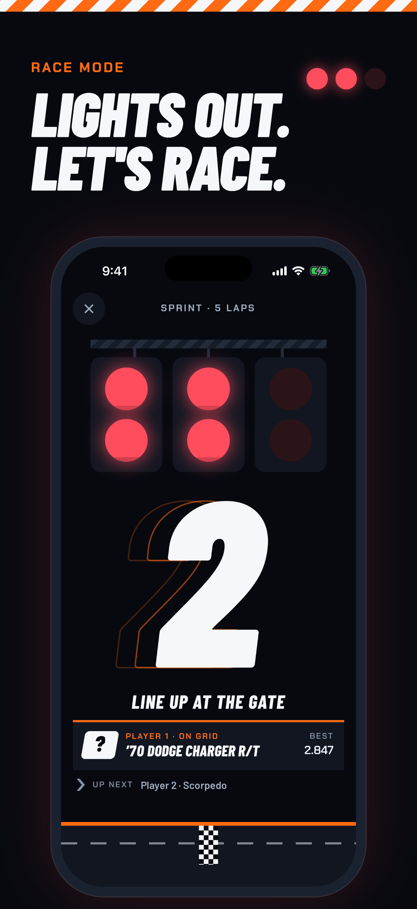
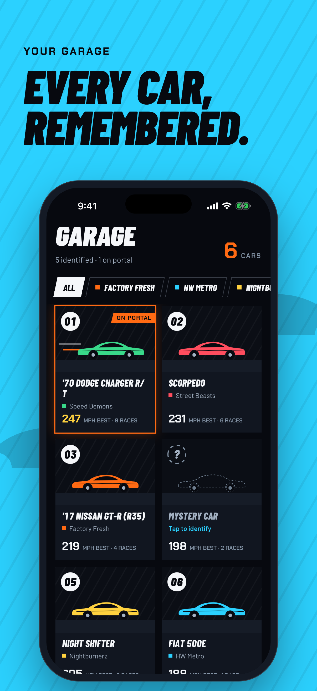

# Redline ID

**Bring your Hot Wheels id Race Portal back to life.**

Mattel shut down the Hot Wheels id app on January 1, 2024, and the Race Portal went quiet with it. Redline ID talks to the portal again over Bluetooth. You get live speed for every pass, lap races, race-night tournaments and a garage that remembers every car.

> **Redline ID 1.0 is out now on the App Store** for iPhone and iPad. It's free, with no account, ads or analytics.

<a href="https://apps.apple.com/us/app/redline-id/id6782271830"></a>

<p align="center">
  
  
  
</p>

## What it does

- **Live speed.** Every car through the gate shows up on an animated gauge, in mph or km/h, with optional calibration.
- **Lap races.** Lights-out starts, a lap clock, per-lap splits, results and personal bests.
- **Race night.** Line up players, assign cars and run a single-elimination tournament.
- **Garage and history.** Each car is recognized by its id chip and keeps its own records. Sessions, and 13 trophies to hunt, are saved too.
- **TV mode.** Mirror the race clock and standings to a TV with AirPlay.
- **Both portal firmwares.** Works with the original open protocol and the newer encrypted one.

Everything stays on your device. There's no account, analytics, ads or server, and Bluetooth is only used to talk to the portal. Requires iOS 16.4 or later.

[Website](https://hyperionstudios.org/redline-id/) · [Support](https://hyperionstudios.org/redline-id/support/) · [Privacy policy](https://hyperionstudios.org/redline-id/privacy/) · [Kids' iPad setup with Guided Access](docs/guides/ios-guided-access.md)

## How it works

The portal advertises as `HWiD` over Bluetooth Low Energy and reports each car's NFC id and speed. There are two firmware generations in the wild:

- **Legacy firmware** exposes speed and car data openly. See [PROTOCOL.md](PROTOCOL.md).
- **Modern (MPID) firmware** sends the same data as an encrypted protobuf stream after an ECDH key exchange. The portal authenticates itself but not the app, so no Mattel secret is needed. See [PROTOCOL_NEW.md](python/PROTOCOL_NEW.md).

The modern-protocol reverse engineering ([`PROTOCOL_NEW.md`](python/PROTOCOL_NEW.md), [`HWiD.proto`](python/HWiD.proto), [`hwportal/mpid.py`](python/hwportal/mpid.py) and the `python/tools/` scripts) is the work of [Mitch Capper (@mitchcapper)](https://github.com/mitchcapper), from his [modern_protocol_support branch](https://github.com/mitchcapper/hotwheels-portal/tree/modern_protocol_support) (MIT). It's vendored here with attribution.

## Build it yourself

| Path | What's there |
| --- | --- |
| [`apps/mobile`](apps/mobile/) | The iOS app (Expo and React Native) |
| [`packages/protocol`](packages/protocol/) | `@redlineid/protocol`, the shared TypeScript BLE protocol port, with tests |
| [`python`](python/) | The original Python terminal tools and reverse-engineering kit |
| [`community`](community/) | The crowd-sourced car identity seed |
| [`site`](site/) | The app's website |
| [`docs`](docs/) | [Architecture](docs/architecture/README.md), [decision records](docs/adr/) and the [roadmap](docs/ROADMAP.md) |

The TypeScript side uses npm workspaces and Node 20 or later:

```bash
npm install
npm run typecheck
npm test
npm run web --workspace mobile -- --port 8081   # browser preview with simulated passes
```

Expo Go can't load the app because it ships a native Bluetooth module, so a real portal needs a development build on a physical iPhone. On a Mac with Xcode, run `npx expo run:ios --device` from `apps/mobile`. The [development build guide](docs/guides/ios-dev-build.md) covers EAS builds, the Simulator and signing.

The Python tools need Python 3.10 or later:

```bash
cd python
python3 -m venv venv && source venv/bin/activate
pip install -r requirements.txt
python dashboard.py      # live terminal speedometer
python race_mode.py      # lap race game
python mpid_monitor.py   # monitor for modern-firmware portals
```

## Contributing

Issues and pull requests are welcome. If your portal behaves differently, or you can help decode what's left of the protocol, please open an issue. You can also help name cars through the [community seed](community/README.md).

## Why this exists

Mattel's shutdown left thousands of Race Portals as paperweights. This project restores them through reverse engineering, so Hot Wheels fans can keep enjoying their hardware. It's a fork of [mtxmiller/hotwheels-portal](https://github.com/mtxmiller/hotwheels-portal), because my children wanted an iPad app. The portal firmware on our device was also different, and decrypting it took significant work beyond the original project.

## Support the project

If Redline ID brought your portal back to life, star the repository, report issues, or [donate with PayPal](https://www.paypal.com/donate/?business=DAABJ7R4P22CC&no_recurring=0&currency_code=USD).

## License

The code is under the [MIT License](LICENSE). The bundled car catalog contains third-party factual metadata with its own source terms, and the app bundles 135 Hot Wheels Wiki car photographs reused under CC BY-SA with per-image credit. Nothing is fetched at runtime. See [THIRD_PARTY_NOTICES.md](THIRD_PARTY_NOTICES.md) and the in-app **Credits & licenses** screen.

Redline ID is published by Hyperion Studios LLC. It's an independent project, and is not affiliated with, endorsed by, or sponsored by Mattel, Inc. "Hot Wheels" and "Hot Wheels id" are trademarks of Mattel, Inc., used here only to describe the discontinued hardware this app works with.
